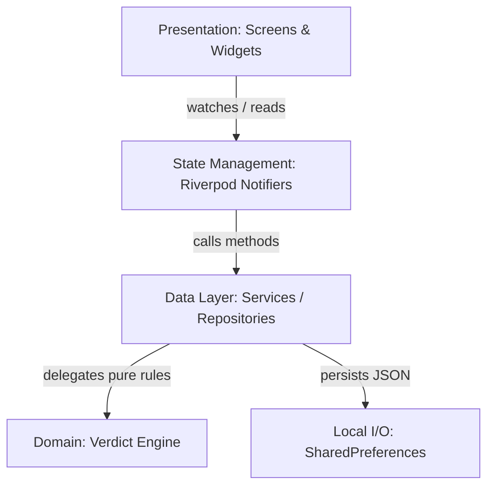

# Service Architecture & Base Contracts

| Field | Value |
|---|---|
| Spec | Base Service Tier & Exception Architecture |
| Status | **Active** — binding specification for Tiny Court core services |
| Target Path | `lib/core/services/` & `lib/core/exceptions/` |
| Reference | `pogo_alarm/app/docs/service_plans/00-service-plans-and-auth-contract.md` |

---

## 1. Architectural Philosophy

Tiny Court follows a strict four-layer architecture:
1. **Presentation Layer:** Flutter Widgets and Pages (declarative, reactive).
2. **State Management Layer:** Riverpod Notifiers / AsyncNotifiers (mediators between UI and business logic).
3. **Domain & Business Logic Layer:** Pure Dart engines (e.g. `VerdictEngine`), validation, and decision rules.
4. **Data / Service Layer:** Repositories and Services providing abstracted CRUD, serialization, and local I/O.

UI widgets **never** directly access `SharedPreferences` or database singletons. All data and business workflows are accessed through interfaces.



---

## 2. Base Service Contract (`lib/core/services/service.dart`)

All services implement a common lifecycle contract:

```dart
/// Marker interface and lifecycle contract for all domain services.
abstract interface class Service {
  /// Initializes any asynchronous resources or cached data.
  Future<void> init();

  /// Releases resources, timers, or stream subscriptions if required.
  void dispose();
}
```

---

## 3. Exception Hierarchy (`lib/core/exceptions/app_exception.dart`)

All service exceptions derive from a strongly typed base exception class to ensure predictable error handling and localization in the UI.

```dart
/// Base application exception.
abstract class AppException implements Exception {
  final String message;
  final String? code;
  final dynamic cause;

  const AppException(this.message, {this.code, this.cause});

  @override
  String toString() => 'AppException[$code]: $message';
}

/// Thrown when a requested case is not found.
class CaseNotFoundException extends AppException {
  CaseNotFoundException(String caseId)
      : super('Case with ID "$caseId" could not be found.', code: 'CASE_NOT_FOUND');
}

/// Thrown when attempting to edit a case that has already received a verdict.
class CaseAlreadyDecidedException extends AppException {
  CaseAlreadyDecidedException(String caseId)
      : super('Case "$caseId" has already been decided and cannot be modified.',
            code: 'CASE_ALREADY_DECIDED');
}

/// Thrown when case submission fails validation (e.g., missing argument).
class CaseValidationException extends AppException {
  final Map<String, String> fieldErrors;

  CaseValidationException(this.fieldErrors)
      : super('Case validation failed.', code: 'CASE_VALIDATION_FAILED');
}

/// Thrown when attempting to regenerate a verdict for a decided case.
class VerdictAlreadyFinalizedException extends AppException {
  VerdictAlreadyFinalizedException(String caseId)
      : super('Verdict for case "$caseId" has already been issued and is immutable.',
            code: 'VERDICT_ALREADY_FINALIZED');
}

/// Thrown when storage I/O fails.
class StorageException extends AppException {
  StorageException(String message, {dynamic cause})
      : super(message, code: 'STORAGE_ERROR', cause: cause);
}
```

---

## 4. Repository Locator Pattern (`lib/data/repository.dart`)

Following the `AppRepository` pattern from the project base:

```dart
import '../core/services/case_service.dart';
import '../core/services/verdict_service.dart';
import '../core/services/settings_service.dart';

class AppRepository {
  late final CaseService caseService;
  late final VerdictService verdictService;
  late final SettingsService settingsService;

  Future<void> init() async {
    // Initialized in dependency order
  }
}
```
