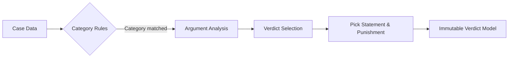

# Verdict Engine & Decision Rules Specification

| Field | Value |
|---|---|
| Spec | Local Pure-Dart Rule-Based Verdict Engine |
| Target Path | `lib/core/engine/verdict_engine.dart` |
| Characteristics | Pure Dart, 100% deterministic, zero async, zero UI dependencies |
| Unit Tests | `test/unit/verdict_engine_test.dart` |

---

## 1. Engine Architecture & Design Goals

The **Verdict Engine** is the comedic brain of Tiny Court. It evaluates the arguments and case metadata to produce a structured, entertaining judgment.

### Principles:
1. **Purity:** No Flutter imports, no network, no database calls. Takes a `Case` and returns a `Verdict`.
2. **Determinism:** Given the same `case.id` and input, running the engine will always produce the identical verdict. (Achieved by using a hash of `case.id` as a pseudo-random seed for tiebreakers).
3. **Comedic Incongruity:** The engine applies disproportionately serious legal rules to petty everyday disputes.



---

## 2. BuiltValue VerdictType (`EnumClass`) (`lib/model/enums/verdict_type.dart`)

```dart
import 'package:built_collection/built_collection.dart';
import 'package:built_value/built_value.dart';
import 'package:built_value/serializer.dart';

part 'verdict_type.g.dart';

class VerdictType extends EnumClass {
  const VerdictType._(super.name);

  static const VerdictType guiltyPlaintiff = _$guiltyPlaintiff; // Plaintiff's claim backfired
  static const VerdictType guiltyDefendant = _$guiltyDefendant; // Defendant found guilty as charged
  static const VerdictType bothGuilty = _$bothGuilty;           // Both parties committed petty misconduct
  static const VerdictType notGuilty = _$notGuilty;             // Defendant acquitted of all charges
  static const VerdictType caseDismissed = _$caseDismissed;     // Judge deems dispute frivolous
  static const VerdictType hungJury = _$hungJury;               // Inconclusive evidence; deadlock

  static BuiltSet<VerdictType> get values => _$values;
  static VerdictType valueOf(String name) => _$valueOf(name);
  static Serializer<VerdictType> get serializer => _$verdictTypeSerializer;
}
```

---

## 3. Decision Rules Matrix

The engine processes cases through three prioritized layers:

### Layer 1: Rule Heuristics
1. **Length Disparity Rule:** If Plaintiff writes 500 words and Defendant writes "ok" or "hmm", trigger the *Summary Contempt of Court* verdict (`guiltyDefendant` for extreme indifference or `caseDismissed`).
2. **Snack Ownership Rule (Food Category):** Keywords like *"pizza"*, *"fries"*, *"labeled"*, *"fridge"*.
   * If food was in fridge > 24 hours: Maritime Salvage Law applies $\rightarrow$ `notGuilty`.
   * If item was labeled: Grand Snack Theft $\rightarrow$ `guiltyDefendant`.
   * If both stole from each other: Mutual Pizza Carnage $\rightarrow$ `bothGuilty`.
3. **Ghosting & Tardy Rules (Relationships/Friendship Category):** Keywords like *"late"*, *"cancelled"*, *"read"*, *"hmm"*.
   * Last minute cancellation within 30 min $\rightarrow$ `guiltyDefendant` with punitive dessert duties.
   * Cancelling due to "being sleepy" $\rightarrow$ `caseDismissed` (Sleep is a constitutional right).

### Layer 2: Seeded Deterministic Selection
If no specific keyword rule is matched, the engine falls back to a deterministic hash of `case.id`:
```dart
int seed = caseData.id.codeUnits.fold(0, (a, b) => a + b);
VerdictType type = VerdictType.values.elementAt(seed % VerdictType.values.length);
```

---

## 4. Comedic Punishment & Decree Catalog

Every verdict contains:
- `judgeStatement`: The solemn headline ruling.
- `explanation`: The satirical legal reasoning.
- `punishment`: The binding sentence/restitution.
- `closingRemark`: The judge's parting words.

### Example Canned Verdict Catalog:

#### Food: Both Guilty
* **Judge Statement:** *"After forensic review of the crumbs, this court finds both parties guilty of culinary negligence."*
* **Explanation:** *"The plaintiff failed to secure their leftovers with adequate security, and the defendant exercised zero moral restraint."*
* **Punishment:** *"Both parties must order a large pizza together, split the bill 50/50, and give the last slice to a dog or houseplant."*
* **Closing Remark:** *"Justice has been served. Extra garlic sauce is mandated."*

#### Friendship: Guilty Defendant
* **Judge Statement:** *"The defendant is found guilty of High Treason for cancelling plans while already dressed."*
* **Explanation:** *"Flaking after 6:00 PM when the plaintiff has already put on shoes constitutes irreversible emotional damages."*
* **Punishment:** *"The defendant must pay for the plaintiff's next coffee and arrive 10 minutes early to the next hangout."*
* **Closing Remark:** *"Court is adjourned. Put your shoes back on."*

---

## 5. Engine Contract (`lib/core/engine/verdict_engine.dart`)

```dart
import '../../model/case.dart';
import '../../model/verdict.dart';

abstract interface class VerdictEngine {
  /// Pure deterministic evaluation of a case.
  Verdict evaluate(Case caseData);
}
```
