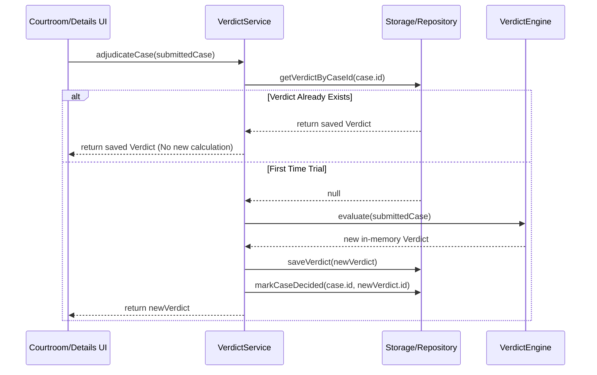

# Verdict Service Specification & Idempotency Contract

| Field | Value |
|---|---|
| Spec | Verdict Service & Idempotency Lifecycle |
| Contract | [`VerdictService`](../../lib/core/services/verdict_service.dart) |
| Model | [`Verdict`](../../lib/model/verdict.dart) (Built Value) |
| References | [`02-verdict-engine-and-rules-spec.md`](02-verdict-engine-and-rules-spec.md) · [`01-case-crud-service-contract.md`](01-case-crud-service-contract.md) |

---

## 1. The Idempotency Principle

A fundamental product requirement for Tiny Court:
> **"The verdict must be generated only once for a decided case and persisted. Reopening a case must display its existing verdict rather than generating a new one."**

The `VerdictService` is responsible for strictly enforcing this principle. It coordinates between the pure-Dart `VerdictEngine` and the local persistence repository.



---

## 2. Domain Model: `Verdict` (`lib/model/verdict.dart`)

```dart
import 'package:built_collection/built_collection.dart';
import 'package:built_value/built_value.dart';
import 'package:built_value/serializer.dart';
import 'enums/verdict_type.dart';

part 'verdict.g.dart';

abstract class Verdict implements Built<Verdict, VerdictBuilder> {
  Verdict._();
  factory Verdict([void Function(VerdictBuilder) updates]) = _$Verdict;

  String get id;
  String get caseId;
  VerdictType get verdictType;

  /// Party or parties deemed responsible (e.g. ['John Doe'] or ['Alice', 'Bob'])
  BuiltList<String> get responsibleParties;

  String get judgeStatement;
  String get explanation;
  String get punishment;
  String get closingRemark;
  String get ruleId;

  DateTime get generatedAt;

  static Serializer<Verdict> get serializer => _$verdictSerializer;
}
```

---

## 3. Core Contract: `VerdictService` (`lib/core/services/verdict_service.dart`)

```dart
import '../services/service.dart';
import '../../model/case.dart';
import '../../model/verdict.dart';

/// Contract for verdict retrieval, generation, and persistence.
abstract interface class VerdictService implements Service {
  /// Fetches an existing verdict by its unique ID.
  Future<Verdict?> getVerdictById(String verdictId);

  /// Fetches the verdict associated with a specific case ID.
  /// Returns null if the case has not yet completed trial.
  Future<Verdict?> getVerdictByCaseId(String caseId);

  /// Performs adjudication:
  /// 1. Verifies if a verdict already exists in persistence (returns it if so).
  /// 2. If not, calls [VerdictEngine.evaluate(submittedCase)].
  /// 3. Saves the verdict in local storage.
  /// 4. Calls [CaseService.markCaseDecided] to link and lock the case.
  /// 5. Returns the finalized verdict.
  Future<Verdict> adjudicateCase(Case submittedCase);

  /// Deletes a verdict associated with a case.
  Future<void> deleteVerdictByCaseId(String caseId);
}
```
