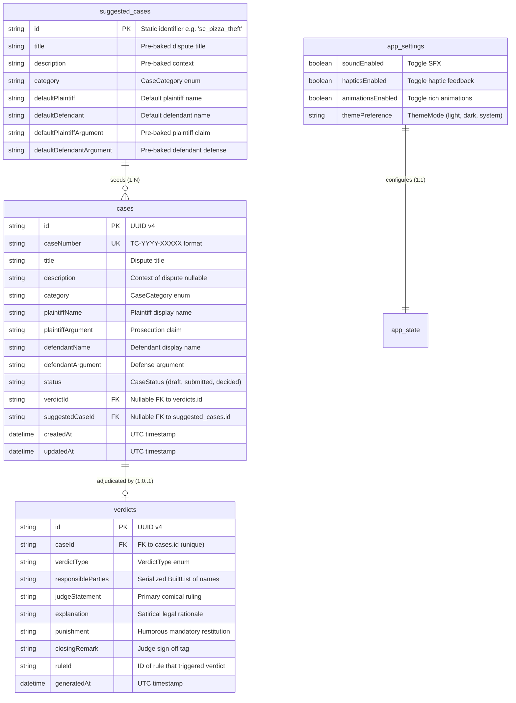

# Database Schema, SharedPreferences Partitioning & ER Diagram

| Field | Value |
|---|---|
| Spec | Local Persistence Architecture & Data Schema |
| Storage Backing | `SharedPreferences` (JSON Key-Value partitioned) |
| Serialization | `built_value` + `serializers.dart` |
| Reference | `pogo_alarm/app/docs/service_plans/04-database-schema-and-er-diagram.md` |

---

## 1. Entity Relationship Diagram (ERD)

---

## 2. SharedPreferences Key Partitioning Architecture

To prevent severe I/O lag caused by serializing a massive monolithic list into a single key on every write, storage is partitioned into distinct indexed documents:

| Key Pattern | Data Type | Description |
|---|---|---|
| `tc_index_case_ids` | `List<String>` | Master index of all saved case IDs in reverse chronological order. |
| `tc_case_{caseId}` | `String` (JSON) | Serialized JSON string for a single `Case` model. |
| `tc_verdict_{caseId}` | `String` (JSON) | Serialized JSON string for a single `Verdict` model. |
| `tc_settings` | `String` (JSON) | Serialized JSON string for `AppSettings`. |
| `tc_seq_case_number` | `int` | Monotonically incrementing integer for generating `TC-YYYY-XXXXX`. |

### Benefits of this partitioning:
1. **Granular Reads/Writes:** Creating or updating a single case does not serialize all other cases.
2. **Instant Deletion:** Deleting a case only removes `tc_case_{id}`, `tc_verdict_{id}`, and pops `{id}` from `tc_index_case_ids`.
3. **Seamless Future Migration:** When migrating from `SharedPreferences` to SQLite/Isar in later versions, the repository interface remains 100% identical.
