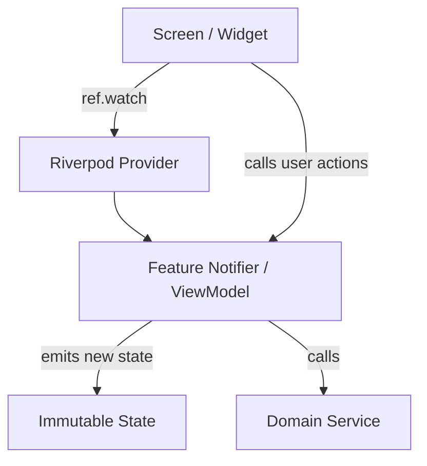

# State Machine & ViewModel Architecture Plan

| Field | Value |
|---|---|
| Spec | Riverpod State Machine & ViewModel Architecture |
| Target Path | `lib/view_model/` |
| Reference | `pogo_alarm/app/docs/state_machine_vm_plan/00-state-machine-vm-plan.md` |
| Pattern | MVVM + Riverpod (`Notifier` & `AsyncNotifier`) |

---

## 1. Architectural Pattern

Every feature has an isolated ViewModel and State pair:
* **State:** Immutable `built_value` or Dart 3 class representing complete screen/feature data.
* **Notifier:** Riverpod `Notifier` or `AsyncNotifier` encapsulating business logic, coordinating with services, and exposing simple user intent methods.

---

## 2. Core ViewModels Index

| # | ViewModel / Notifier | Path | Scope |
|---|---|---|---|
| **V1** | `CaseDraftNotifier` | `lib/view_model/case_creation/case_draft_notifier.dart` | Creation wizard, form steps, field validation, template seeding |
| **V2** | `CourtroomNotifier` | `lib/view_model/courtroom/courtroom_notifier.dart` | 6-stage courtroom sequence orchestrator, auto-play, skip |
| **V3** | `CaseHistoryNotifier` | `lib/view_model/case_history/case_history_notifier.dart` | Case list, search query, category/status filters, deletion |
| **V4** | `SettingsNotifier` | `lib/view_model/settings/settings_notifier.dart` | Toggling sound, haptics, theme |
