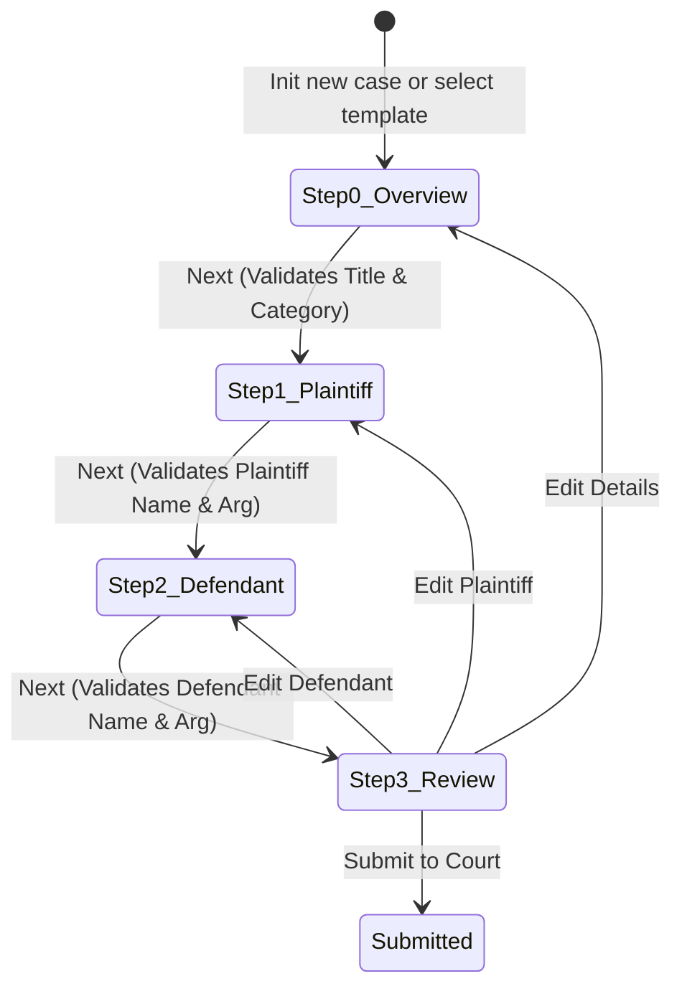

# Case Draft Wizard ViewModel Specification

| Field | Value |
|---|---|
| Spec | Multi-Step Case Creation State Machine |
| Target Path | `lib/view_model/case_creation/case_draft_notifier.dart` |
| State Model | `CaseDraftState` |
| Target Routes | `/cases/create`, `/cases/:id/edit`, `/cases/:id/review` |

---

## 1. Wizard Steps & State Machine

The case creation flow is a 4-step wizard:



---

## 2. Domain Step Enum & BuiltValue State Model: `CaseDraftState`

```dart
import 'package:built_collection/built_collection.dart';
import 'package:built_value/built_value.dart';
import 'package:built_value/serializer.dart';
import '../../model/enums/case_category.dart';

part 'case_draft_state.g.dart';

/// Strongly-typed wizard step enum
enum DraftStep {
  overview,   // Title, category, description
  plaintiff,  // Plaintiff name & argument
  defendant,  // Defendant name & argument
  review;     // Full docket review prior to filing

  int get index => switch (this) {
    DraftStep.overview => 0,
    DraftStep.plaintiff => 1,
    DraftStep.defendant => 2,
    DraftStep.review => 3,
  };
}

abstract class CaseDraftState implements Built<CaseDraftState, CaseDraftStateBuilder> {
  CaseDraftState._();
  factory CaseDraftState([void Function(CaseDraftStateBuilder) updates]) = _$CaseDraftState;

  String? get draftId;
  DraftStep get activeStep;
  String get title;
  CaseCategory get category;
  String? get description;
  String get plaintiffName;
  String get plaintiffArgument;
  String get defendantName;
  String get defendantArgument;
  String? get suggestedCaseId;

  bool get isSubmitting;
  BuiltMap<String, String> get fieldErrors;

  // Step validation helpers
  bool get isOverviewValid => title.trim().isNotEmpty;
  bool get isPlaintiffValid =>
      plaintiffName.trim().isNotEmpty && plaintiffArgument.trim().isNotEmpty;
  bool get isDefendantValid =>
      defendantName.trim().isNotEmpty && defendantArgument.trim().isNotEmpty;
  bool get canSubmit => isOverviewValid && isPlaintiffValid && isDefendantValid;

  static Serializer<CaseDraftState> get serializer => _$caseDraftStateSerializer;
}
```

---

## 3. Notifier Contract (`CaseDraftNotifierContract`)

The contract defines the explicit public API of the state machine, isolating UI event dispatch from internal state updates and enabling painless unit/widget test mocking.

```dart
import '../../model/case.dart';
import '../../model/suggested_case.dart';
import '../../model/enums/case_category.dart';
import 'case_draft_state.dart';

abstract interface class CaseDraftNotifierContract {
  /// Seeds wizard from a pre-made template prompt.
  void initFromTemplate(SuggestedCase template);

  /// Resumes an existing saved draft.
  void initFromExistingDraft(Case existingCase);

  /// Clears form state and resets wizard to Step 0.
  void reset();

  /// Updates Overview fields (Step 0).
  void updateOverview({
    required String title,
    required CaseCategory category,
    String? description,
  });

  /// Updates Plaintiff fields (Step 1).
  void updatePlaintiff({
    required String name,
    required String argument,
  });

  /// Updates Defendant fields (Step 2).
  void updateDefendant({
    required String name,
    required String argument,
  });

  /// Navigates directly to a specific step.
  void goToStep(DraftStep step);

  /// Validates the current step and advances to the next step.
  /// Returns false if current step has validation errors.
  bool nextStep();

  /// Returns to the previous step.
  void previousStep();

  /// Submits the case to court and transitions status to Submitted.
  /// Returns the submitted Case model or null if submission fails.
  Future<Case?> submitCase();
}
```
