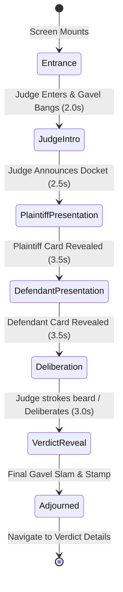

# Courtroom Orchestrator State Machine Specification

| Field | Value |
|---|---|
| Spec | Choreographed Courtroom Session State Machine |
| Target Path | `lib/view_model/courtroom/courtroom_notifier.dart` |
| Target Route | `/courtroom/:id` |
| Reference | `pogo_alarm/app/docs/state_machine_vm_plan/00-state-machine-vm-plan.md` |

---

## 1. Courtroom Sequence Lifecycle

The courtroom experience is an interactive sequence of 6 dramatic stages. Users can either let it auto-play or tap to progress immediately.



---

## 2. Courtroom Stage Enum & BuiltValue State Model: `CourtroomState`

```dart
import 'package:built_value/built_value.dart';
import 'package:built_value/serializer.dart';
import '../../model/case.dart';
import '../../model/verdict.dart';

part 'courtroom_state.g.dart';

enum CourtroomStage {
  entrance,              // Mascots enter, ambient courtroom sound
  judgeIntro,            // Judge says "Order in the court!"
  plaintiffPresentation, // Plaintiff argument card slides in
  defendantPresentation, // Defendant rebuttal card slides in
  deliberation,          // Judge thinking animation, scales wobble
  verdictReveal,         // Gavel slam, verdict stamp appears
  adjourned;             // Trial complete, proceed to details
}

abstract class CourtroomState implements Built<CourtroomState, CourtroomStateBuilder> {
  CourtroomState._();
  factory CourtroomState([void Function(CourtroomStateBuilder) updates]) = _$CourtroomState;

  Case get courtCase;
  CourtroomStage get currentStage;
  Verdict? get generatedVerdict;
  bool get isAutoPlaying;
  bool get isSkipped;
  String get currentJudgeDialogue;

  static Serializer<CourtroomState> get serializer => _$courtroomStateSerializer;
}
```

---

## 3. Orchestrator Contract

```dart
abstract interface class CourtroomOrchestratorContract {
  void initializeSession(String caseId);
  void progressToNextStage();
  void skipToVerdict();
  void toggleAutoPlay(bool enable);
  void disposeSession();
}
```
