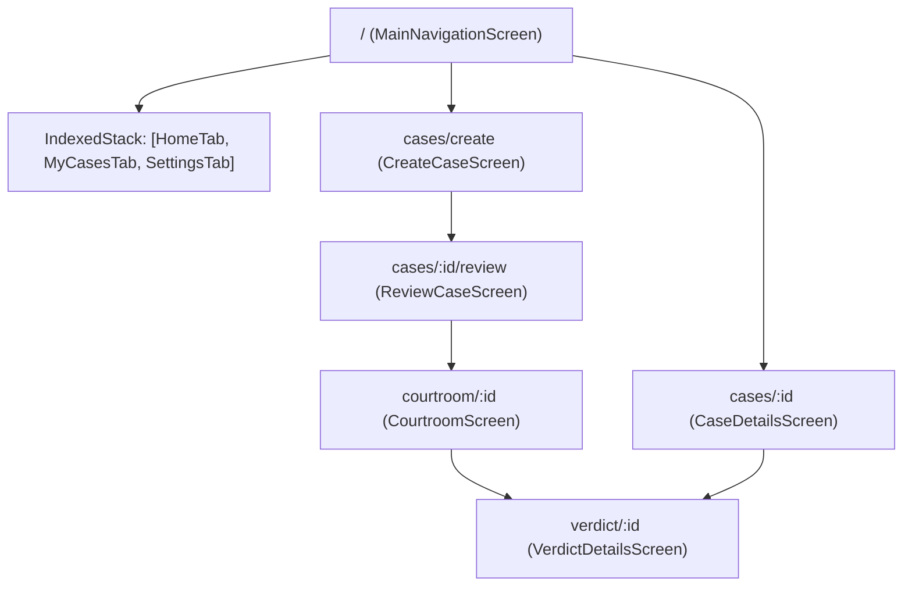

# Routes & Navigation Specification

| Field | Value |
|---|---|
| Spec | Simplified Typed Routing with `go_router` & `go_router_builder` |
| Target Path | `lib/views/navigation/` |
| Pattern | Single Root `IndexedStack` for Tabs + Nested Child Routes |
| Reference | `pogo_alarm/app/docs/ui_master_plan/03-routes-pages.md` |

---

## 1. Architectural Philosophy: No Complex Shell Route

Rather than introducing complex GoRouter shell branches (`StatefulShellRoute`), Tiny Court uses a streamlined, bulletproof architecture:
1. **Root Screen (`MainNavigationScreen` at `/`):** Holds a standard `NavigationBar` and an `IndexedStack` managing the 3 main tabs (`HomeTab`, `MyCasesTab`, `SettingsTab`). Tab state, scroll position, and search inputs are preserved natively in memory with zero router boilerplate.
2. **Nested Child Routes:** All full-screen interactive flows (Case Creation, Review, Courtroom, Verdict, Case Details) are declared as child routes under `/`.
   * Calling `context.go('/cases/create')` or `context.go('/courtroom/:id')` automatically covers the screen, hides the bottom navigation bar, and maintains the root `/` on the back stack so the back arrow (`<`) works automatically.
   * Calling `context.go('/')` on the Verdict screen clears the courtroom stack and cleanly resets to the Home tab.



---

## 2. Typed Route Definitions (`lib/views/navigation/app_router.dart`)

```dart
import 'package:flutter/material.dart';
import 'package:go_router/go_router.dart';

part 'app_router.g.dart';

@TypedGoRoute<MainNavigationRouteData>(
  path: '/',
  routes: <TypedRoute<RouteData>>[
    TypedGoRoute<CreateCaseRouteData>(path: 'cases/create'),
    TypedGoRoute<ReviewCaseRouteData>(path: 'cases/:id/review'),
    TypedGoRoute<CourtroomRouteData>(path: 'courtroom/:id'),
    TypedGoRoute<VerdictRouteData>(path: 'verdict/:id'),
    TypedGoRoute<CaseDetailRouteData>(path: 'cases/:id'),
  ],
)
class MainNavigationRouteData extends GoRouteData {
  const MainNavigationRouteData();

  @override
  Widget build(BuildContext context, GoRouterState state) {
    return const MainNavigationScreen();
  }
}

class CreateCaseRouteData extends GoRouteData {
  final String? templateId;
  const CreateCaseRouteData({this.templateId});

  @override
  Widget build(BuildContext context, GoRouterState state) {
    return CreateCaseScreen(templateId: templateId);
  }
}

class ReviewCaseRouteData extends GoRouteData {
  final String id;
  const ReviewCaseRouteData({required this.id});

  @override
  Widget build(BuildContext context, GoRouterState state) {
    return ReviewCaseScreen(caseId: id);
  }
}

class CourtroomRouteData extends GoRouteData {
  final String id;
  const CourtroomRouteData({required this.id});

  @override
  Widget build(BuildContext context, GoRouterState state) {
    return CourtroomScreen(caseId: id);
  }
}

class VerdictRouteData extends GoRouteData {
  final String id;
  const VerdictRouteData({required this.id});

  @override
  Widget build(BuildContext context, GoRouterState state) {
    return VerdictDetailsScreen(caseId: id);
  }
}

class CaseDetailRouteData extends GoRouteData {
  final String id;
  const CaseDetailRouteData({required this.id});

  @override
  Widget build(BuildContext context, GoRouterState state) {
    return CaseDetailsScreen(caseId: id);
  }
}
```

---

## 3. `MainNavigationScreen` Implementation Spec

```dart
class MainNavigationScreen extends StatefulWidget {
  const MainNavigationScreen({super.key});

  @override
  State<MainNavigationScreen> createState() => _MainNavigationScreenState();
}

class _MainNavigationScreenState extends State<MainNavigationScreen> {
  int _currentIndex = 0;

  final List<Widget> _tabs = const [
    HomeTab(),
    MyCasesTab(),
    SettingsTab(),
  ];

  @override
  Widget build(BuildContext context) {
    return Scaffold(
      body: IndexedStack(
        index: _currentIndex,
        children: _tabs,
      ),
      bottomNavigationBar: NavigationBar(
        selectedIndex: _currentIndex,
        onDestinationSelected: (index) {
          setState(() => _currentIndex = index);
        },
        destinations: const [
          NavigationDestination(
            icon: Icon(Icons.gavel_outlined),
            selectedIcon: Icon(Icons.gavel),
            label: 'Home',
          ),
          NavigationDestination(
            icon: Icon(Icons.folder_outlined),
            selectedIcon: Icon(Icons.folder),
            label: 'My Cases',
          ),
          NavigationDestination(
            icon: Icon(Icons.settings_outlined),
            selectedIcon: Icon(Icons.settings),
            label: 'Settings',
          ),
        ],
      ),
    );
  }
}
```
