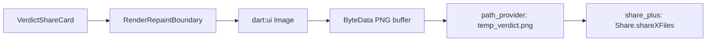

# Verdict Share Card & Quality Assurance Plan

| Field | Value |
|---|---|
| Spec | Image Export, Native Share & QA Test Strategy |
| Target Path | `lib/utils/share_utils.dart` & `test/` |
| Reference | `pogo_alarm/app/docs/ui_master_plan/05-qa-closeout.md` |

---

## 1. Social Share Card Specification

The verdict share card is captured off-screen or rendered via a dedicated modal:
1. **Widget:** `VerdictShareCard` wrapped in a `RepaintBoundary`.
2. **Dimensions:** High-resolution fixed canvas ($1080 \times 1350$ px, 4:5 aspect ratio optimized for Instagram / WhatsApp stories).
3. **Card Contents:**
   * Tiny Court Header & Official Seal.
   * Case Number (e.g. `TC-2026-0042`) and Category badge.
   * Case Title (e.g. *"The Case of the Missing Pizza Slice"*).
   * Parties: Plaintiff vs Defendant badges.
   * Prominent Verdict Stamp (e.g. `BOTH GUILTY`).
   * The Judge's Statement & Comedic Punishment decree.
   * Tiny Court watermark footer (*"Every silly argument deserves its day in court"*).

---

## 2. Technical Image Pipeline

---

## 3. Quality Assurance & Test Matrix

### A. Unit Tests (Business Logic & Engine)
* `test/unit/verdict_engine_test.dart`:
  * Keyword mapping (food, friendship, work, relationships).
  * Argument length disparity rules.
  * Seeded determinism verification (same input $\rightarrow$ same output).
* `test/unit/case_crud_test.dart`:
  * Create, update, submit, and transition guards (cannot update decided cases).
* `test/unit/model_serialization_test.dart`:
  * Built Value round-trip serialization tests.

### B. State Machine Tests
* `test/unit/case_draft_notifier_test.dart`:
  * Wizard step progression and field validation.
* `test/unit/courtroom_notifier_test.dart`:
  * Complete 6-stage lifecycle progression and skip handling.

### C. Widget & Smoke Tests
* `test/widget/home_screen_test.dart`:
  * Mascot rendering, template carousel scroll, and navigation hooks.
* `test/widget/courtroom_screen_test.dart`:
  * Stage rendering and gavel animation completion.
